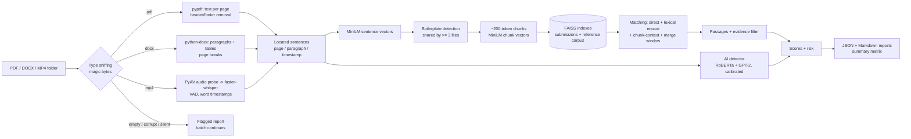
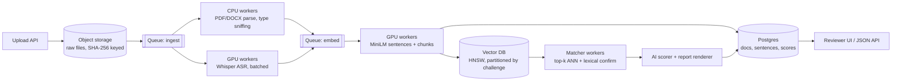

# Multimodal Submission Integrity & Plagiarism Detection Engine

A CLI pipeline that ingests a folder of **PDF, DOCX and MP4** submissions, turns every file into located text (page, paragraph or video timestamp), and scores each submission on three separate signals:

* **Peer similarity**: overlap with other submissions, including **cross-modal** copying (a video reading out a classmate's PDF).
* **External similarity**: overlap with a local reference corpus that simulates web search.
* **AI-generated probability**: a calibrated text-likelihood estimate.

Every flag comes with the **exact matching passages**, sentence-by-sentence alignment, page numbers or timestamps, and similarity metrics, so a reviewer can verify a claim in under 30 seconds.

| Result on the bundled 15-file dataset | |
|---|---|
| Brief scenarios 1–5 | **5 / 5 pass** (automatically checked against ground truth) |
| Pair-level copy detection (78 pairs) | **Precision 1.00 · Recall 1.00** (exact, paraphrase, cross-modal) |
| AI-text detector (54-paragraph benchmark, leave-one-out) | **ROC-AUC 0.94 · accuracy 0.91** |
| Test suite | **42 tests pass** (`pytest`) |

These are results on a small synthetic dataset. See [EVALUATION.md](EVALUATION.md) for the confusion matrices, ablations, failure analysis and caveats.

---

## 1. Quick start

**Setup** (Python ≥ 3.10; tested on 3.11, Windows 11, CPU only):

```bash
python -m venv .venv
# Windows: .venv\Scripts\activate      macOS/Linux: source .venv/bin/activate
pip install -r requirements.txt
```

**Run** (from the repository root):

```bash
python run_integrity_check.py --input_dir ./sample_submissions --output_dir ./reports
```

`python run_integrity_check.py` with no arguments does the same. The first run downloads about 1.3 GB of open models from Hugging Face and caches them. After that, the 15-file sample takes about 70 seconds on a laptop CPU (measured: 69 s, Intel laptop, no GPU used). No system `ffmpeg` is needed: audio is decoded through PyAV.

| Optional command | Purpose |
|---|---|
| `python scripts/download_models.py` | Pre-fetch all models (e.g. before going offline) |
| `pytest` | Run the 42 unit/integration tests (generates edge-case files on the fly) |
| `python scripts/evaluate.py` | Re-compute every metric in EVALUATION.md against `dataset_manifest.json` |
| `python scripts/calibrate_ai.py` | Rebuild the AI-detector benchmark and its calibration |
| `python scripts/build_dataset.py` | Regenerate the sample dataset (needs `requirements-dev.txt`, Windows SAPI voices) |
| `python scripts/fetch_reference_corpus.py` | Re-download the pinned Wikipedia reference corpus |

CLI flags: `--config`, `--reference_dir`, `--template_file` (an official prompt to always discount), `--device auto|cpu|cuda`, `--no_ai`, `--log_level`. Exit code `0` means the batch finished; individual bad files are flagged, not fatal. Exit code `2` means invalid arguments.

### Outputs

```
reports/
├── <file>.json      machine-readable report (brief's schema + extensions)
├── <file>.md        human-readable audit report
├── summary.json     batch table + N×N peer-similarity matrix
├── summary.md       the same, readable (start here)
└── run.log
```

The committed `reports/` folder contains the output of the sample run, so you can read results without running anything. Start with [reports/summary.md](reports/summary.md), then for example [the paraphrase case](reports/submission_04.docx.md), [the cross-modal case](reports/pitch_01.mp4.md) or [the silent video](reports/pitch_03.mp4.md).

---

## 2. Repository layout

```
run_integrity_check.py      CLI entry point (single root command)
config.yaml                 every threshold and model name, documented
integrity/                  the engine (one module per stage)
  extractors/               pdf_extractor, docx_extractor, media_extractor (Whisper), type sniffing
  normalize.py              Unicode/whitespace/hyphenation repair, header/footer removal
  segmentation.py           located sentences, citation detection
  chunker.py                ~200-token overlapping chunks
  embedder.py               Sentence-Transformers wrapper (unit-normalised vectors)
  indexer.py                FAISS index with document-level self-match exclusion
  boilerplate.py            shared-template detection (Scenario 4)
  matching.py               peer / cross-modal / external passage matching
  ai_detect.py              AI-text likelihood (RoBERTa + GPT-2 perplexity/burstiness, calibrated)
  scoring.py                percentages and risk level
  reporter.py               JSON + Markdown reports, batch summary
  pipeline.py               orchestration (extract -> analyse)
  resources/ai_calibration.json
sample_submissions/         15 test files + dataset_manifest.json (ground truth)
reference_corpus/           14 pinned pre-2022 Wikipedia articles (external "web")
benchmarks/ai_detection/    human vs AI paragraphs used to calibrate the AI detector
scripts/                    dataset builder, evaluation, calibration, model download
tests/                      pytest suite (edge cases generated on the fly)
evaluation/results.json     raw output of scripts/evaluate.py
reports/                    output of the sample run (committed for convenience)
```

---

## 3. How it works



### 3.1 Ingestion and normalisation (Task 1)

| Format | How | Location kept |
|---|---|---|
| PDF | `pypdf` text per page. Paragraphs are rebuilt from visual lines: a line counts as a heading or table row only if it is short in characters, unpunctuated and ≤ 12 words. Running headers/footers are removed: short lines in the top or bottom 3 lines that repeat on ≥ 50 % of pages once digits are masked, plus bare page numbers. A safety valve never deletes most of a page. | page |
| DOCX | The body XML is walked in document order, so **tables are not lost** (`Document.paragraphs` skips them). Headers/footers are separate package parts and are excluded. Heading styles are recognised. | page (from explicit or rendered page breaks), paragraph |
| MP4 (any audio/video) | PyAV checks that an audio stream exists. **faster-whisper** `base` (CTranslate2 build of OpenAI Whisper; int8 on CPU) transcribes with **Silero VAD** and Whisper's no-speech rule, which stops hallucinated "Thank you." on silence. Word timestamps are re-assembled into sentences. | start–end timestamp per sentence |
| TXT | UTF-8 text | paragraph |

* **Normalisation** never rewrites wording, because reports quote verbatim. It applies NFKC (which also folds PDF ligatures such as `fi`→`fi`), strips soft hyphens, control and zero-width characters, re-joins line-end hyphenation, and collapses whitespace.
* **Sentences** come from a rule-based splitter: deterministic, with no model download. It protects abbreviations (`Ltd.`, `e.g.`), initials (`M. E. Porter`) and decimals (`4.2%`). Bibliography entries, whether under a *References* heading or matching APA/DOI/URL patterns in short blocks, are labelled `citation` and never count as plagiarism. Sentences shorter than 6 words are kept for context but are not evidence: "Thank you." matches everything and proves nothing.
* **Chunks** are about 200 tokens with a one-sentence overlap, counted with the **embedding model's own tokenizer**. `all-MiniLM-L6-v2` silently truncates anything past **256 word pieces**, so a 400-token chunk would have half of it ignored. Chunks never split a sentence, and they are built from assessed (non-template) sentences only.
* **Robustness**: the file type comes from **magic bytes**, not the extension. A PDF renamed to `.docx` is still read, with a warning. Every file is processed inside its own error boundary. Possible statuses: `OK`, `EMPTY_FILE`, `CORRUPT_FILE`, `PASSWORD_PROTECTED`, `UNSUPPORTED_TYPE`, `NO_TEXT` (scanned PDF; OCR is out of scope), `NO_AUDIO_TRACK`, `NO_SPEECH`, `ERROR`. A non-OK file gets an `UNPROCESSABLE` report with the reason, and the batch continues.

### 3.2 Embeddings, index and peer similarity (Task 2)

* **Model**: `sentence-transformers/all-MiniLM-L6-v2`. It produces 384-dimensional vectors, has 22 M parameters and runs fast on a CPU.
* **Cosine via inner product**: vectors are L2-normalised at encode time, so for unit vectors a·b = ‖a‖‖b‖cos θ = cos θ. A FAISS `IndexFlatIP` therefore returns exact cosine similarities.
* **Self-match exclusion** works at the **document** level, not just the vector level. Overlapping chunks of the same file are near-duplicates and would otherwise fill every neighbour list. The search over-fetches by the number of vectors the query's own file contributes, then drops them, so *k* foreign neighbours are always returned. There is a unit test for this.
* **Matching** runs coarse to fine, and every similarity is a cosine (see `integrity/matching.py`):
  1. **Direct**: a sentence pair counts when cosine ≥ **0.85**.
  2. **Lexical rescue**: retrieved candidates with cosine 0.70–0.85 also count when their normalised **Levenshtein ≥ 0.70**. Small edits, a dropped acronym or an ASR spelling ("fulfillment") lower the cosine of an obvious copy but not its character overlap. Semantic retrieval proposes; lexical similarity confirms.
  3. **Context (paraphrase)**: when two ~200-token chunks have cosine ≥ **0.85**, the sentences inside them are aligned with a relaxed threshold of **0.60**. On the dataset the true paraphrase pair has chunk cosine **0.89**, while the most similar *independent* pair reaches only **0.81**. Single-sentence cosines overlap (0.89 vs 0.84), so the chunk gate carries the paraphrase decision.
  4. **Merge window**: a sentence may align with **two consecutive** source sentences, because copiers merge and split sentences and Whisper segments speech differently from the PDF.
  5. **Counterpart choice**: when several sentences of one document qualify, the one with the highest cosine + Levenshtein is kept. This picks the sentence that was actually copied, not another sentence that merely says something similar.
  6. **Passages and evidence filter**: matched sentences that are adjacent in both files are merged into passages. A lone sentence that is only semantically similar is reported only if cosine ≥ 0.90 or its wording also overlaps. Same-topic answers share such sentences by chance.
* **Percentages** are word-weighted over *assessed* words, meaning eligible prose that is not boilerplate:

  `peer % = 100 × (words of assessed sentences matched in ≥ 1 other submission) / (assessed words)`

  The summary matrix holds `coverage[i][j]` = % of file *i*'s assessed words matched in file *j*. It is asymmetric by design: a paragraph copied into a long report is 100 % of the copier's row but a small share of the source's.

### 3.3 Shared template / boilerplate (Scenario 4)

A sentence is treated as template when near-identical copies (cosine ≥ 0.90) occur in at least `max(3, ⌈10 % × N⌉)` distinct submissions. Copying between **two** students stays visible; text shared by **many** is the case prompt, question wording or a standard citation. The fraction term keeps the rule meaningful at scale: at 10,000 submissions, three files sharing a paragraph is a collusion signal, not a template. Boilerplate is excluded from evidence **and** from the denominator, and is listed in each report under "Discounted template text" so the decision stays transparent. `--template_file prompt.pdf` additionally discounts a known official prompt.

### 3.4 External similarity and AI likelihood (Task 3)

* **External ("web") engine**: the brief allows a local knowledge base. `reference_corpus/` holds 14 Wikipedia articles related to the case domain, each **pinned to its last revision before 2022-11-01**. That makes runs reproducible and gives a genuinely human-written corpus. The corpus is indexed and matched exactly like submissions, and reports cite *article, paragraph N* plus a link to the exact revision. Reference embeddings are cached on disk, keyed by model and content hash.
* **AI-generated probability** combines three open-model signals:
  1. a RoBERTa classifier fine-tuned on ChatGPT vs human answers (`Hello-SimpleAI/chatgpt-detector-roberta`);
  2. GPT-2 **perplexity**, computed as the mean token negative log-likelihood with a context-preserving sliding window;
  3. **burstiness**, the standard deviation of per-sentence NLL.

  They are combined by a **standardised logistic regression** fitted by `scripts/calibrate_ai.py` on a benchmark of 26 human paragraphs (pre-ChatGPT Wikipedia) vs 28 LLM paragraphs on the same topics. It reaches leave-one-out ROC-AUC 0.94, and it turns the classifier's overconfident 0.999/0.001 outputs into usable probabilities. Template text is excluded before scoring. Texts under 80 words return `null` with status `INSUFFICIENT_TEXT` rather than a made-up number. Speech transcripts are marked low-confidence.

### 3.5 Risk level

| Level | Rule (thresholds in `config.yaml`) |
|---|---|
| **HIGH** | max(peer %, external %) ≥ 30, **or** AI ≥ 85 % with a normal-confidence estimate |
| **MEDIUM** | max(peer %, external %) ≥ 10, **or** AI ≥ 60 % |
| **LOW** | otherwise |
| **UNPROCESSABLE** | file could not be analysed (reason in the report) |

A low-confidence AI estimate (transcript or short text) can raise risk to MEDIUM at most: an unreliable signal must not trigger a penalty on its own. The report also states that similarity is symmetric, so it cannot tell which file is the original.

### 3.6 Explainability (Task 4)

Each Markdown report is laid out for a 30-second check:

1. A score banner and a one-paragraph verdict naming files, pages or timestamps, and the reason for the risk level.
2. An evidence table: type, source, *here → there* location, cosine, Levenshtein, match kind.
3. For each match, both passages quoted side by side. For non-verbatim matches, the shared content words are **bold**.
4. A **sentence-alignment table**: each copied sentence next to its source sentence with its own cosine and evidence method.
5. Discounted template text, AI signals with caveats, and processing warnings.

The JSON report keeps the brief's keys and order exactly (`document_id`, `total_integrity_risk`, `scores`, `peer_matches`, `multimodal_matches`, `explanations`). Every key is plain ASCII: the brief's PDF renders `matched_file` with a ligature character, and that is deliberately not copied. Extra sections are added after them: `external_matches`, `boilerplate_passages`, `ai_assessment`, `risk_reasons`, `processing`, `score_details`. Every match also carries `match_type` (verbatim / near_verbatim / paraphrase), `chunk_similarity`, `lexical_similarity` (Jaccard, Levenshtein), `evidence` and `sentence_alignment`.

Abridged example from `reports/pitch_01.mp4.json`:

```json
{
  "document_id": "pitch_01.mp4",
  "total_integrity_risk": "HIGH",
  "scores": {"peer_similarity_percentage": 87.1, "external_similarity_percentage": 0.0, "ai_generated_probability": null},
  "peer_matches": [],
  "multimodal_matches": [{
    "matched_file": "submission_05.pdf",
    "similarity_score": 1.0,
    "query_passage": "We looked at the direct-to-consumer option through the lens of customer lifetime value. ...",
    "matched_passage": "We looked at the direct-to-consumer option through the lens of customer lifetime value. ...",
    "location": {"query_timestamp": "00:00:03 - 00:00:24", "matched_page": 2},
    "match_type": "verbatim", "chunk_similarity": 0.783,
    "lexical_similarity": {"jaccard": 0.95, "levenshtein": 0.966}
  }],
  "explanations": "87.1% of the assessed text overlaps with other submissions: submission_05.pdf (87.1% of this file, cross-modal verbatim, at 00:00:03 - 00:00:24). ..."
}
```

---

## 4. Scenario handling

| Scenario | What the engine does | Evidence in this repo |
|---|---|---|
| 1. Cross-modal duplication | Whisper transcript with word timestamps → matched against the PDF index → `multimodal_matches` with `matched_page` / `matched_timestamp` in **both** files' reports | `pitch_01.mp4` ↔ `submission_05.pdf`: **00:00:03–00:00:24 ↔ page 2** (ground truth 3.0–23.4 s, page 2) |
| 2. Paraphrased content | Chunk-context alignment; every match reports cosine next to Jaccard/Levenshtein | `submission_03.docx` ↔ `submission_04.docx`: **chunk cosine 0.89**, Jaccard 0.27, Levenshtein 0.46, 11/13 sentences aligned |
| 3. Corrupted / empty | Size and magic-byte checks, audio-stream probe, VAD; per-file error boundary | `submission_12.pdf` → `EMPTY_FILE`, `pitch_03.mp4` → `NO_AUDIO_TRACK`; the other 13 files analysed. Tests also cover encrypted, image-only, truncated, mislabelled and silent-audio files |
| 4. Shared template | Corpus-frequency boilerplate rule + citation detection | 147 template words discounted in each of the 5 prompt files; `submission_11.docx` (prompt + original answer) → **LOW, 0 %** |
| 5. Batch | Whole folder (recursive), aggregate table + N×N matrix | `reports/summary.md` |

---

## 5. Sample dataset

`sample_submissions/` contains 15 files: **7 PDF, 5 DOCX, 3 MP4** (10–30 s each). They are synthetic answers to a fictional case ("Kestrel Foods Ltd."). `dataset_manifest.json` records the ground truth:

* the exact copy pair (`01.pdf` → `02.docx`, across formats);
* the paraphrase pair (`03` ↔ `04`, both DOCX);
* the cross-modal pair (`05.pdf` read aloud in `pitch_01.mp4`, with the page and the measured time window);
* external copies (`09.pdf` from Wikipedia "Vertical integration" / "Gross margin"; `pitch_02.mp4` reading "Supply chain management");
* the 150-word shared prompt in 5 files;
* one LLM-generated answer (`06.pdf`);
* three independent originals: `07` (same case, the hard negative), `08` (different case) and `11`;
* a heavily formatted PDF (`10`), a zero-byte PDF (`12`) and a video with no audio track (`pitch_03`).

The speech is offline text-to-speech (Windows SAPI). See the *provenance* note in the manifest about how the texts were authored.

---

## 6. Scaling to 10,000 submissions (Task 5)

### 6.1 Architecture



* **Stage queues** (SQS, RabbitMQ or Redis Streams with Celery/Dramatiq). Each stage scales independently: parsing is CPU-bound, ASR and embedding are GPU-bound. Tasks are **idempotent and keyed by the file's SHA-256**, so retries are safe and byte-identical resubmissions are caught for free as exact copies. Failures retry with back-off, then go to a dead-letter queue, and the file is reported `UNPROCESSABLE` exactly as in the prototype.
* **Two phases.** (1) Per-file work (extract → transcribe → embed → AI score) is embarrassingly parallel. (2) Corpus-level work needs the whole challenge. Boilerplate document-frequency counts are maintained incrementally, with a final reconciliation pass when the submission window closes, so reports issued early are re-scored if a passage later turns out to be shared template.
* **Incremental matching.** A new file queries the existing index (top-k), is inserted, and **back-notifies** the files it matched so their reports gain the reverse match. This avoids recomputing all pairs.

### 6.2 Vector index choice: Flat vs HNSW vs IVF-PQ

Assume 10,000 submissions × ~80 sentences = **0.8 M sentence vectors** and ~0.1 M chunk vectors, each 384-d float32.

| Index | Memory (0.8 M × 384) | Query | When to use |
|---|---|---|---|
| Flat (exact) | 0.8 M × 384 × 4 B ≈ **1.2 GB** | O(N) per query; an all-vs-all batch is ≈ 2.5×10¹⁴ FLOPs ≈ seconds on one GPU (FAISS-GPU), minutes on CPU | Batch re-scoring of one challenge; ground-truth recall checks |
| **HNSW** (M = 32, efSearch = 128) | ≈ 1.2 GB + graph ≈ 0.2 GB | ~1 ms, sub-linear, recall typically > 0.95 | **Default for production**: online/incremental queries, filtering by `challenge_id` |
| IVF-PQ (e.g. 4096 lists, 64-byte codes) | ≈ 0.05 GB | Fast, lossy | Beyond ~10–100 M vectors (multi-year archives), with lexical re-checking of candidates |

The prototype uses exact Flat search, the right choice for 15 files. `VectorIndex(kind="hnsw")` is already implemented and tested, with the same owner-aware self-exclusion. In production I'd use **Qdrant** (HNSW, payload filters per challenge, on-disk vectors, scalar quantisation) or **pgvector HNSW** if the platform already runs Postgres. Matching stays two-step either way: approximate retrieval proposes the top-k candidates, then exact cosine plus Levenshtein confirms them. So approximate-search errors can cost a little recall but never create false evidence.

### 6.3 Compute, throughput and cost (order-of-magnitude, stated assumptions)

Assumptions: 70 % documents averaging ~2,000 tokens; 30 % videos averaging 3 minutes (production pitches are longer than the 10–60 s samples); NVIDIA T4-class GPUs.

| Stage | Volume | Hardware | Estimate |
|---|---|---|---|
| Parsing | 7,000 PDF/DOCX | CPU, ~0.2–1 s/file | ≈ 0.5–2 core-hours; trivially parallel |
| ASR (Whisper base, batched, fp16) | 3,000 × 3 min = 150 h of audio | GPU at roughly 50–100× real time | ≈ **2–3 GPU-hours** (the dominant cost). Whisper `small` for better accented-speech accuracy costs about 2–3× more |
| Embeddings (MiniLM) | ~0.8 M sentences + 0.1 M chunks | GPU, several thousand sentences/s | ≈ 5 GPU-minutes |
| AI detector (GPT-2 + RoBERTa) | ~20 M tokens | GPU | ≈ 15–30 GPU-minutes |
| Matching | 0.9 M top-k ANN queries | CPU/GPU | minutes |

At cloud spot prices of roughly US$0.2–0.5 per T4-hour, **a whole 10,000-submission challenge costs a few dollars of compute**. With 4 GPU workers plus autoscaled CPU workers, the wall-clock time is under an hour. Per-file latency after upload is about a minute for documents and roughly the clip duration ÷ 50 for videos.

**Bottlenecks and mitigations**

* **ASR throughput.** Use batched GPU inference, VAD to skip silence, and `tiny` for triage with `base`/`small` re-runs on flagged files. Sharding by challenge keeps queues fair.
* **Scanned PDFs.** These need OCR (Tesseract or a document AI model) in a separate CPU queue, with its own latency SLO.
* **Long tails.** A 200-page report or a 30-minute video gets timeouts, chunked processing and a size-based priority queue.
* **Precision at scale.** More submissions means more chance-level similarity. The boilerplate fraction rule, the evidence-strength filter and lexical confirmation already target this. Thresholds should be re-calibrated per challenge on a labelled sample.
* **Model hosting.** Use Triton or TorchServe with dynamic batching, and quantised (int8) models for CPU-only deployments.
* **Data protection.** Student files stay in a private bucket, embeddings are stored instead of raw text where possible, retention policies apply, and **no submission content is sent to third-party APIs**. All models run in-house.

---

## 7. Assumptions

1. **Schema extensions.** The brief's JSON example has no field for external matches, but Task 4 requires every overlap to be cited. All brief keys are kept verbatim and in order, and `external_matches` and the other sections are **added after them**.
2. **`peer_matches` vs `multimodal_matches`.** A match is *multimodal* when exactly one side is a speech transcript (MP4 ↔ PDF/DOCX). PDF ↔ DOCX is the same modality (text), so it is a peer match. Both count towards `peer_similarity_percentage`.
3. **Location fields.** For a video's own report the mirror form `{"query_timestamp", "matched_page"}` is used. External matches cite `matched_paragraph` of the reference article. Page ranges add `*_page_end`.
4. **DOCX page numbers.** A .docx stores no layout, so the page comes from explicit page breaks, or Word's rendered-page markers when present. Paragraph numbers are always kept.
5. **Similarity scale.** Percentages are 0–100 and `similarity_score` is a 0–1 cosine, matching the brief's example.
6. **"cosine > 0.80" for paraphrase** is treated as an example, not a fixed rule. Thresholds were calibrated on the dataset (sweep in EVALUATION.md). The paraphrase pair's chunk cosine (0.89) is reported in the match.
7. **Missing values are `null`, not 0.** Unprocessable files have `null` scores. An AI estimate on under 80 words of prose is `null` with a reason, because 0 % would claim certainty that doesn't exist.
8. **Risk levels.** Only "HIGH" appears in the brief. LOW / MEDIUM / HIGH / UNPROCESSABLE are defined in §3.5.
9. **Chunk size.** About 200 tokens (within the suggested 200–400) because MiniLM truncates at 256.
10. **Clip length.** The brief gives both 10–60 s and 10–30 s; the sample clips follow the stricter 10–30 s.
11. **Python version.** The brief says 3.9+. The code uses 3.9-compatible syntax, but current torch/transformers releases require ≥ 3.10 (3.9 reached end-of-life in Oct 2025), so 3.10+ is required and 3.11 was tested.
12. **Whisper implementation.** `faster-whisper` runs the same open Whisper weights (an "equivalent open model") and needs no system ffmpeg, which makes setup a single command.
13. **Metadata files are skipped.** `dataset_manifest.json`, README and hidden files in the input folder are not submissions. Unsupported types (e.g. `.png`) still get an `UNPROCESSABLE` report.
14. **No direction of copying.** Similarity is symmetric, so both files of a pair are flagged. Who copied whom needs submission timestamps, which is out of scope.

## 8. Limitations and next steps

* The evaluation dataset is small and synthetic, and thresholds were tuned on it. See EVALUATION.md for how this was mitigated and what it means for the reported numbers.
* There is no OCR, so scanned PDFs are flagged `NO_TEXT`. The models are English-only: non-English text is flagged with a warning, and `paraphrase-multilingual-MiniLM-L12-v2` would be the drop-in fix.
* ASR normalisation ("three hundred" → "300", US/UK spelling) lowers lexical scores of spoken copies. Number and spelling normalisation is the next improvement.
* AI detection is a probabilistic signal with known biases, for example against non-native writers. It must never be the sole basis for a penalty, which is why it is capped at MEDIUM when its confidence is low.

## 9. Use of AI coding assistants (disclosure)

I planned the assignment, the pipeline and the deliverables, and decided what to build and how. To work efficiently (writing all the code by hand takes much longer), Claude helped me implement it: code, documentation and the synthetic dataset texts, including the LLM-generated samples. I can explain every component in the interview.

## 10. Data and model credits

* Wikipedia articles in `reference_corpus/` and `benchmarks/ai_detection/human.jsonl`: © Wikipedia contributors, **CC BY-SA 4.0**. The exact revision links are in `reference_corpus/manifest.json`.
* Models: all-MiniLM-L6-v2 (Apache-2.0), Whisper via faster-whisper (MIT), GPT-2 (MIT), chatgpt-detector-roberta (HC3 project), Silero VAD (MIT).
* Everything else is synthetic; no real student data is used.
